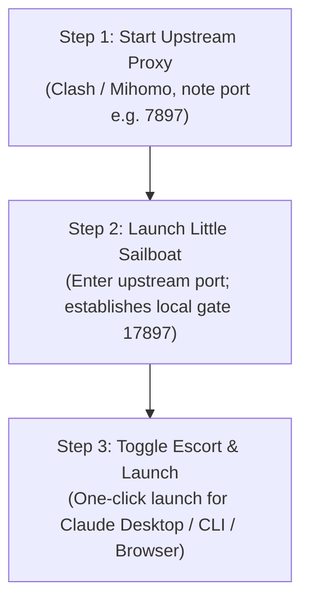

<div align="center">


# Little Sailboat · 小帆船
### Native Environment Orchestration & Fail-Safe Console for Claude & Claude Code

<p align="center">
  <strong>Navigate your AI development in a transparent, pure, and strictly controlled environment.</strong>
</p>

[](https://github.com/zhongyuanl/xiaofanchuan/releases/tag/v1.3.19)
[](https://github.com/zhongyuanl/xiaofanchuan/releases/tag/v1.3.19)
[](https://github.com/zhongyuanl/xiaofanchuan/releases/tag/v1.3.19)
[](https://github.com/zhongyuanl/xiaofanchuan)
[](https://github.com/zhongyuanl/xiaofanchuan/releases)

**[简体中文](README.md) | [English](README.en.md)**

[**📥 Download v1.3.19**](https://github.com/zhongyuanl/xiaofanchuan/releases/tag/v1.3.19) · [**📖 User Guide**](docs/USER_GUIDE.en.md) · [**⚠️ Precautions & Privacy**](docs/PRECAUTIONS.en.md) · [**🐛 Report an Issue**](https://github.com/zhongyuanl/xiaofanchuan/issues)

</div>

---

## 💡 Why Little Sailboat?

When developers interact with **Claude Web/Desktop** and **Claude Code CLI** across regions or strict network environments, they frequently encounter cumbersome hurdles:

- **Accidental Direct Leaks**: When upstream proxies drop or fluctuate, client connections can silently fall back to direct internet routes, leaking your real IP and triggering account flags.
- **Environment Discrepancies**: Network traffic originates from one region while system timezone, language, or IPv6 reflect another, producing inconsistent fingerprint signals.
- **Fragile CLI Configurations**: Constantly exporting terminal environment variables is tedious, and manually altering `~/.claude/settings.json` easily corrupts syntax or accidentally deletes existing API keys and custom gateways.
- **Browser Profile Cross-Contamination**: Daily web activities and AI coding workflows share the same browser profile, mixing cookies, history, and extensions without sandbox boundaries.

**Little Sailboat provides a lightweight, modern orchestrator designed specifically to solve these problems.** It consolidates local fail-safe proxy gating, dual-source exit diagnostics, timezone alignment, config safety snapshots, and 1-click launchers into an elegant native dashboard.

---

## ✨ Core Feature Matrix

| Feature | Description | Value |
| :--- | :--- | :--- |
| 🛡️ **Fail-Safe Local Gateway**<br>`Port 17897` | Operates an exclusive local relay on `127.0.0.1:17897`. Traffic is permitted only after validation; drops connections immediately on network faults | **Zero Bypass Leaks**: Never silently falls back to direct connections |
| 🌐 **Dual-Source Honest Probing**<br>`Exit Verification` | Concurrently queries verified IP intelligence APIs to confirm exit IPv4, ASN, ISP, and geographic consistency | **Honest Telemetry**: No synthetic fraud scores; true state at a glance |
| 🚀 **Unified Launch Station**<br>`All-in-One Launcher` | Single-click launcher for Claude Desktop, Claude Code CLI, and dedicated sandboxed browsers (Edge / Chrome) | **Frictionless Onboarding**: Automatically mounts verified proxies and environment paths |
| 🌍 **System Environment Alignment**<br>`Locale & Timezone Harmony` | Inspects system language, timezone, and IPv6 consistency against the proxy exit region | **Fingerprint Coherence**: Eliminates conflicting signals that trigger risk detection |
| 💾 **Claude Code Config Sentinel**<br>`Non-Destructive Snapshots` | Automatically creates timestamped backups (retains latest 5) before writes; strictly validates JSON syntax and preserves `sk-ant-` keys | **Zero Data Loss**: Instant 1-click rollback to previous valid configurations |
| 🧰 **Tiered Session & Data Repair**<br>`Granular Governance` | Tiered operations: "Sign out only", "Clear runtime cache", or "Full environment reset" with path preview | **Precision Control**: Eliminates indiscriminate data deletion |

---

## 🖼️ Interface Showcase

<div align="center">

### 1. Dashboard & Passage Control
Real-time monitoring of exit IP, ISP details, geographic location, and local gateway status with single-click launcher controls.


<br/>

### 2. Environment & Network Settings
Easily configure upstream proxy ports (e.g., Clash 7897), align regional preferences, and inspect system details.


</div>

---

## 📥 Download & Installation

Little Sailboat offers native builds for both **macOS (Apple Silicon)** and **Windows (x64)**:

### Release Download Matrix

| Platform | Asset File | Recommendation | Description |
| :--- | :--- | :--- | :--- |
| **macOS** (13.0+) | [**`Little-Sailboat-v1.3.19-macOS.dmg`**](https://github.com/zhongyuanl/xiaofanchuan/releases/download/v1.3.19/Little-Sailboat-v1.3.19-macOS.dmg) | ⭐⭐⭐⭐⭐ **Recommended** | Open DMG and drag `Little Sailboat.app` to Applications |
| **macOS** (13.0+) | [`Little-Sailboat-v1.3.19-macOS.zip`](https://github.com/zhongyuanl/xiaofanchuan/releases/download/v1.3.19/Little-Sailboat-v1.3.19-macOS.zip) | ⭐⭐⭐⭐ | Portable archive |
| **macOS** (13.0+) | [`Little-Sailboat-v1.3.19-app.tar.gz`](https://github.com/zhongyuanl/xiaofanchuan/releases/download/v1.3.19/Little-Sailboat-v1.3.19-app.tar.gz) | ⭐⭐⭐ | Complete App Bundle tarball archive |
| **Windows** (10/11) | [**`Little-Sailboat-v1.3.19-Windows-x64.exe`**](https://github.com/zhongyuanl/xiaofanchuan/releases/download/v1.3.19/Little-Sailboat-v1.3.19-Windows-x64.exe) | ⭐⭐⭐⭐⭐ **Recommended** | Standalone single-executable with built-in WebView2 loader |
| **Windows** (10/11) | [`Little-Sailboat-v1.3.19-Windows-x64.zip`](https://github.com/zhongyuanl/xiaofanchuan/releases/download/v1.3.19/Little-Sailboat-v1.3.19-Windows-x64.zip) | ⭐⭐⭐⭐ | Includes documentation and portable executable |

> [!TIP]
> **Checksum Verification**: Checksum lists are published with each release. Verify downloaded files using [`SHA256SUMS.txt`](https://github.com/zhongyuanl/xiaofanchuan/releases/download/v1.3.19/SHA256SUMS.txt) and [`SHA256SUMS-Windows.txt`](https://github.com/zhongyuanl/xiaofanchuan/releases/download/v1.3.19/SHA256SUMS-Windows.txt).

---

## ⚡ Quick Start: 3 Steps to Launch



1. **Step 1: Prepare Upstream Proxy**
   - Ensure your proxy client (Clash Verge Rev, Mihomo Party, etc.) is connected, and note the mixed/HTTP port (default is often `7897`).
2. **Step 2: Configure & Inspect**
   - Launch Little Sailboat, enter the proxy port in **Environment → Network**, and select your target region.
   - Little Sailboat initializes the local fail-safe gate on `127.0.0.1:17897` and runs dual-source IP and ASN consistency checks.
3. **Step 3: Engage Escort & Launch**
   - Once metrics show a healthy status, toggle on **Security Escort**.
   - Launch **Claude Desktop**, **Claude Code CLI**, or **Sandboxed Browser Profile** with clean, pre-configured network isolation.

---

## 🏗️ Recommended Deployment Setups

| Mode | Setup | Highlights | Best For |
| :--- | :--- | :--- | :--- |
| **A. Dedicated macOS VM**<br>*(Power User Choice)* | Run a dedicated macOS virtual machine (via UTM or Parallels) hosting Little Sailboat, proxy, and Claude tools | **Total Isolation**: Zero impact on host system settings, timezone, or daily browsing data | Heavy AI developers seeking strict profile boundaries |
| **B. Native Host Mode**<br>*(Daily Efficient Use)* | Run directly on your primary Apple Silicon Mac | **Zero Overhead**: Native performance and instant access without virtualization RAM allocation | Daily lightweight coding workflows |
| **C. Windows Standalone**<br>*(Zero-Install Portable)* | Run the single `.exe` executable directly via WebView2 | **Ultra Portable**: Zero setup required; run anywhere | Windows 10/11 environments |

---

## 🛡️ Security, Privacy & Boundary Principles

- **🔒 Pure Local Utility**: Little Sailboat is strictly a client-side environment orchestrator and launch station. **This project does not bundle, sell, or distribute proxy servers, subscriptions, or third-party accounts.**
- **🛡️ Controlled Scope**: The fail-safe gate controls traffic routed through `127.0.0.1:17897` and processes launched by the console. It does not tamper with unrelated system processes.
- **💾 Configuration Safety First**: All configuration modifications adhere to the **Check → Snapshot → Reversible** principle to prevent accidental data loss. See [Precautions & Privacy](docs/PRECAUTIONS.en.md) for details.

---

## ❓ FAQ

<details>
<summary><strong>Q1: macOS says "App is damaged" or "Unidentified developer"?</strong></summary>

Because this open-source build uses ad-hoc signing:
1. Open **System Settings → Privacy & Security** and click **Open Anyway**;
2. Or clear the quarantine attribute via terminal:
   ```bash
   sudo xattr -rd com.apple.quarantine "/Applications/Little Sailboat.app"
   ```
</details>

<details>
<summary><strong>Q2: Should I enter port 7897 or 17897 in settings?</strong></summary>

- `7897` is your **upstream proxy port** from your proxy client (enter this in settings);
- `17897` is **Little Sailboat's local fail-safe gate**, automatically assigned to Claude applications.
</details>

<details>
<summary><strong>Q3: Why does Windows ask for WebView2 Runtime?</strong></summary>

Windows edition utilizes Microsoft Edge WebView2 for rendering. It is pre-installed on Windows 11 and recent Windows 10 releases. If missing on streamlined systems, download it from [Microsoft's official site](https://developer.microsoft.com/microsoft-edge/webview2/).
</details>

<details>
<summary><strong>Q4: Is Intel (x86_64) Mac supported?</strong></summary>

The current macOS binary is compiled natively for Apple Silicon (arm64). Intel Macs are not supported in this release.
</details>

---

## 🤝 Acknowledgements & Open Source Credits

Little Sailboat builds upon great contributions from the open-source ecosystem:
- [CCBaga](https://github.com/liseami/CCBaga): Rust region catalogue and matching logic (MIT License).
- [Clash Verge Rev](https://github.com/clash-verge-rev/clash-verge-rev) & [Mihomo](https://github.com/MetaCubeX/mihomo): Benchmark proxy architectures and documentation.
- [Magic UI](https://github.com/magicuidesign/magicui), [Impeccable](https://github.com/pbakaus/impeccable), [Emil Kowalski skills](https://github.com/emilkowalski/skills): UI aesthetics and interaction inspiration.

Refer to [References & Licenses](docs/REFERENCES.en.md) and [THIRD_PARTY_NOTICES.txt](THIRD_PARTY_NOTICES.txt) for license notices.

---

<div align="center">

**⛵ Smooth sailing for your AI development journey.**  
Contributions, feedback, and [Issues](https://github.com/zhongyuanl/xiaofanchuan/issues) are warmly welcomed!

</div>
