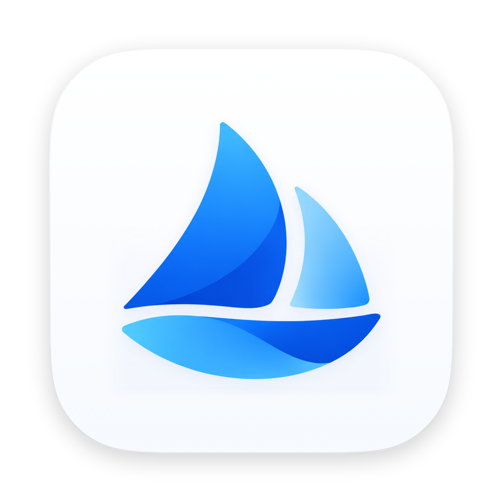
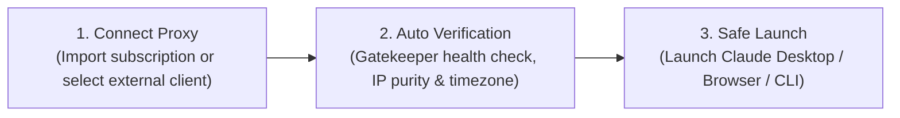

# Little Sailboat · 小帆船
### Native Environment Orchestration & Security Harbor for Claude & Claude Code

  <strong>Empowering every AI interaction in a pure, transparent, and fail-closed secure harbor.</strong>

**[简体中文](README.md)** · **[English](README.en.md)** · **[User Guide](docs/USER_GUIDE.en.md)** · **[Precautions & Privacy](docs/PRECAUTIONS.en.md)** · **[Issues](https://github.com/zhongyuanl/xiaofanchuan/issues)**

---

## 💡 Why Do Claude Accounts Get Unexpectedly Suspended?

When utilizing **Claude Web / Desktop** alongside **Claude Code (CLI)**, developers frequently encounter sudden account risk flags or permanent suspensions. In most cases, the issue does not stem from your prompts, but from silent environment and network discrepancies at the OS level:

- **⚠️ Silent Direct Fallback**: When upstream proxy nodes fluctuate or momentarily disconnect, standard operating systems silently fall back to direct local networking, immediately exposing your real local IP to Anthropic's strict anti-fraud checks;
- **⚠️ CLI & Subprocess Leaks**: When running Claude Code in the terminal, toolchains calling `npx`, `uvx`, `git`, `curl`, and background MCP command-line processes routinely ignore conventional proxy environment variables, connecting directly at the kernel level;
- **⚠️ Contradictory Fingerprints**: Your IP exit is overseas, while your local OS clock remains in another timezone, DNS requests leak to local ISPs, and WebRTC/STUN protocols quietly broadcast your physical IP;
- **⚠️ Session Contamination & Teleportation**: Mixing AI workflows with everyday web browsing contaminates browser cookies; shifting between remote exit regions within hours triggers suspicious geographical teleportation flags.

**Little Sailboat (小帆船) is engineered from the ground up to eliminate these risks.**  
It unites a fail-closed local gatekeeper, a kernel-level dual-engine proxy substrate, comprehensive environment verification, and an isolated tri-terminal launcher into an impeccably designed native control center.

---

## 🌟 Key Highlights & Architectural Innovations

### 🍏 1. Authentic Apple Glass Aesthetic & 3D Interactive Dot-Matrix Globe
- **Pure Swift 6 + SwiftUI + AppKit Architecture**: Zero Electron bloat, instantaneous launch, and native frosted glass surfaces seamlessly blended into macOS.
- **422pt Interactive 3D Dot-Matrix Globe**: Powered by AppKit low-level gesture tracking. Smooth 360° mouse rotation, double-click auto-centering, authentic origin-to-destination departure arcs, and pulsating concentric exit wave animations.
- **Adaptive Uniform Card Geometry**: Under the minimum `900×650` window size, all three core cards (Proxy Environment, Security Guard, and Launch Claude) maintain uniform height and breathing room without needing to scroll.

### 🛡️ 2. Fail-Closed Gatekeeper Proxy (`127.0.0.1:17897`)
- **Fail-Closed by Design**: Dedicated local security gatekeeper. If network connectivity drops or the proxy tunnel experiences an outage, the gatekeeper immediately severs transmission—**never allowing unprotected direct traffic through, preventing accidental local IP exposure**.
- **Full-Spectrum Environment Consistency**: Real-time IP purity detection (residential vs. datacenter), compliance verification across 185 supported countries/regions, and automatic OS timezone alignment.
- **Resilient Tunnel Liveness**: Employs millisecond-level tunnel probes; as long as the underlying proxy tunnel is alive and the exit IP is unchanged, temporary upstream API timeouts will never cause false disconnects.

### ⚡ 3. Mandatory Dual Substrate: System Proxy + TUN Virtual Interface
- **Zero-Leak Guarantee**: Automatically activates **System Proxy + TUN Virtual Interface** simultaneously. Standard desktop apps and browsers utilize high-speed HTTP/SOCKS proxies, while the TUN virtual adapter captures 100% of CLI tools, MCP subprocesses, UDP packets, and system DNS at the kernel level.
- **Total DNS & WebRTC Privacy**: Enforces encrypted remote DoH DNS and blocks STUN protocols to achieve true zero DNS and WebRTC leaks.

### 🌐 4. Dual Engine Flexibility & Smart Split vs. Full Global Tunneling
- **Built-in Mihomo Core**: Dedicated internal proxy engine (`17898/17899/17895`) supporting direct subscription imports, single-node latency testing, and asynchronous concurrent batch benchmarks.
- **Seamless External Client Integration**: Deep compatibility with external proxy tools. Features **One-Click System Proxy Repair**, automatically identifying active physical network adapters (Wi-Fi, Ethernet, USB) and restoring configurations in seconds.
- **Intuitive Split Tunneling**:
  - **Smart Split (Default & Recommended)**: Domestic websites, messaging apps, and LAN connections route directly via local broadband at full speed; Claude services and overseas traffic route through the secure proxy tunnel. Easily convert any URL into a direct rule with one paste.
  - **Full Global (Heavy Scenarios)**: Routes 100% of system traffic through the overseas tunnel for dedicated cross-border workflows.

### 🚀 5. Tri-Terminal Isolated Sandboxed Launcher
- **Claude Official Desktop**: One-click launch with managed proxy settings and child MCP process protection.
- **Dedicated Sandboxed Browser**: Standalone sandbox profile completely isolated from your daily browser—eliminating cookie cross-contamination.
- **Claude Code CLI Terminal**: Automatically injects proxy environment variables and local gatekeeper parameters—no more manual `export` or corrupted `settings.json`.
- **Clean Exit Protection**: Cleanly terminates managed Claude processes upon closing Little Sailboat, ensuring no application is left running unguarded.

### 🧭 6. 24-Hour Anti-Teleportation & Multi-Account Isolation
- Detects geographical jumps and only registers travel changes when Claude is actively utilized, avoiding false flags from background node testing.
- Complete data isolation across multiple Claude accounts.

---

## 🖼️ Interface Preview

### 1. Passage Dashboard
Uniform three-card layout: 3D interactive globe with live outbound flight paths; Security Guard monitoring the fail-closed gatekeeper; one-click launcher for Desktop, Browser, and CLI.

 

### 2. Proxy Environment & Subscriptions
Manage subscriptions and node lists, run single-node latency benchmarks, and toggle between built-in and external proxies effortlessly.

 

### 3. Environment & Settings Center
Harmonize timezone settings, configure network ports, and access the built-in Setup Assistant and one-click proxy repair tools.

> 📌 *Note: Subscription names, node labels, and network exits shown in the screenshots are example data for demonstration purposes.*

---

## 📥 Downloads & Installation

| Platform | Version | Packages | Requirements | Notes |
| :--- | :--- | :--- | :--- | :--- |
| **macOS** | **v2.0.3** | [**DMG Image**](https://github.com/zhongyuanl/xiaofanchuan/releases/download/v2.0.3/Little-Sailboat-v2.0.3-macOS.dmg) · [ZIP Archive](https://github.com/zhongyuanl/xiaofanchuan/releases/download/v2.0.3/Little-Sailboat-v2.0.3-macOS.zip) | Apple Silicon (M1/M2/M3/M4), macOS 13.0 or later | Native Swift 6 build with custom drag-to-install DMG interface |
| **Windows** | **v1.3.23** | [**Standalone EXE**](https://github.com/zhongyuanl/xiaofanchuan/releases/download/v1.3.23/Little-Sailboat-v1.3.23-Windows-x64.exe) · [ZIP Archive](https://github.com/zhongyuanl/xiaofanchuan/releases/download/v1.3.23/Little-Sailboat-v1.3.23-Windows-x64.zip) | Windows 10 / 11 64-bit | Portable single executable powered by WebView2 |

> 💡 **macOS Installation Note**:  
> Open the DMG and drag **Little Sailboat (小帆船)** into the Applications folder. As this open-source release uses ad-hoc signing, if macOS displays a Gatekeeper prompt on first launch, open **System Settings → Privacy & Security** and click **Open Anyway**. Verify packages using [SHA256SUMS.txt](https://github.com/zhongyuanl/xiaofanchuan/releases/download/v2.0.3/SHA256SUMS.txt).

---

## ⚡ Quick Start: 3 Steps to Launch

1. **Step 1: Connect Proxy**
   - In **Environment → Proxy**, import your subscription link or select an external proxy client.
2. **Step 2: Automated Verification**
   - Little Sailboat detects exit IP purity, region compliance, and validates local timezone alignment.
3. **Step 3: Safe Harbor Launch**
   - Toggle **Security Guard** ON, and launch **Claude Desktop**, **Sandbox Browser**, or **Claude Code CLI** with complete peace of mind!

---

## 🛡️ Security, Compliance & Principles

- **Neutral Auxiliary Console**: Little Sailboat is strictly a client-side environment health and launch orchestration utility. **This project does NOT provide, host, or sell any proxy nodes, subscriptions, or accounts.** Users must provide their own network services.
- **Controlled, Non-Intrusive**: The local gatekeeper proxy only manages explicitly routed traffic and processes launched by Little Sailboat; it does not install invasive kernel hooks.
- **Configuration Asset Protection**: Employs automated snapshot backups for developer configurations, protecting your settings and API keys. Learn more in [Precautions & Privacy](docs/PRECAUTIONS.en.md).

---

## 🤝 Acknowledgments & Ecosystem

Little Sailboat stands on the shoulders of remarkable open-source projects:
- [Mihomo](https://github.com/MetaCubeX/mihomo): Industry-leading proxy core reference.
- [CCBaga](https://github.com/liseami/CCBaga): Excellent region mapping logic and dictionary reuse.
- [Clash Verge Rev](https://github.com/clash-verge-rev/clash-verge-rev): Superb cross-platform client architecture.

Detailed licensing terms can be found in [LICENSE](LICENSE.md), [References & Licenses](docs/REFERENCES.en.md), and [THIRD_PARTY_NOTICES.txt](THIRD_PARTY_NOTICES.txt).

---

**⛵ Navigating AI with confidence, privacy, and control.**  
Feel free to open an [Issue](https://github.com/zhongyuanl/xiaofanchuan/issues) or star the repo to support continuous development!

