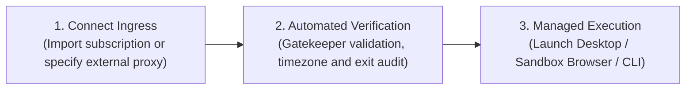

# Little Sailboat (小帆船)
### Execution Environment Security Console for Claude & Claude Code

Client-side security orchestration and runtime environment governance system for macOS and Windows

[简体中文](README.md) · [English](README.en.md) · [User Guide](docs/USER_GUIDE.en.md) · [Precautions & Privacy](docs/PRECAUTIONS.en.md) · [Issues](https://github.com/zhongyuanl/xiaofanchuan/issues)

---

## 1. Background & Threat Model Analysis

During the active development and operational execution of Claude Desktop, web clients, and Claude Code (CLI), the client runtime environment and low-level networking face systemic security vulnerabilities that frequently trigger unexpected account restrictions or session terminations:

- Silent Fallback and True IP Leakage: Upon intermittent connection degradation or disconnection of an upstream proxy tunnel, host operating systems tend to silently revert to the default physical network interface, exposing the domestic public IP to target endpoint servers and prompting automated fraud mitigation.
- Subprocess Bypass in CLI Environments: When Claude Code executes compilation tasks, script toolchains, and multiple sub-agents, spawned child processes—such as npx, uvx, git, curl, and arbitrary Model Context Protocol (MCP) binaries—frequently bypass upper-layer proxy environment configurations and dispatch requests directly via default interfaces.
- Contradictory Fingerprint Signatures: While outbound traffic may terminate at overseas endpoints, host system timezone settings, local resolver DNS queries, and WebRTC STUN handshakes continue to broadcast genuine physical network markers, producing conflicting environmental telemetry.
- Session Cross-Contamination & Exit Drift: Utilizing general-purpose browsers for concurrent browsing and development creates cookie and cache cross-contamination; abrupt geospatial jumps across distinct geopolitical regions within brief intervals trigger abnormal access flags.

Little Sailboat introduces a dedicated governance layer that integrates fail-closed gatekeeping, dual-engine traffic interception, environment synchronization, and isolated process sandboxing to guarantee consistent, auditable, and secured client execution.

---

## 2. Core System Architecture & Engineering Principles

### 2.1 Fail-Closed Gatekeeper Mechanism
The system establishes a dedicated local security gateway bound to 127.0.0.1:17897, enforcing mandatory verification and gatekeeping across all managed traffic:
- Fail-Closed Interception: If upstream proxy tunnels degrade, node reachability fails, or baseline environmental prerequisites are violated, the local gatekeeper immediately severs connectivity, eliminating silent fallbacks to unproxied local paths.
- Comprehensive Environmental Verification: Integrated outbound telemetry validates IP purity (datacenter versus residential classifications), verifies compliance against 185 officially supported regions, and ensures strict timezone alignment, while supporting Chinese language exemptions.
- Resilient Tunnel Keep-Alive: High-frequency telemetry verifies underlying tunnel liveness, filtering isolated API timeouts to maintain persistent workflow continuity when underlying connectivity remains intact.

### 2.2 Dual-Substrate Network Interception (System Proxy + TUN Interface)
Conventional proxy implementations frequently fail to govern non-standard protocol traffic and terminal command-line processes. Little Sailboat enforces dual-substrate interception at the operating system level:
- Comprehensive Capture: Concurrently engages system HTTP/SOCKS proxy endpoints alongside a kernel-level TUN virtual adapter. Standard desktop applications and browsers route through standard proxy channels, while terminal processes, MCP toolchains, UDP packets, and system-level DNS queries are completely intercepted by the TUN driver.
- Zero-Leak Boundary: Integrates remote encrypted DNS-over-HTTPS (DoH) services and enforces STUN protocol interception, preventing DNS leakage and WebRTC enumeration.

### 2.3 Dual-Engine Orchestration & Routing Topologies
- Dedicated Embedded Core: Hosts an embedded proxy kernel supporting direct subscription synchronization, individual node latency evaluation, and asynchronous concurrent benchmarking.
- External Client Compatibility & Repair: Compatible with existing third-party proxy clients; provides an integrated System Proxy Repair utility that dynamically identifies active physical interfaces (Wi-Fi, Ethernet, or USB adapters) and restores proxy parameters in real time.
- Flexible Routing Topologies:
  - Smart Split Routing: Directs domestic services, local network segments, and internal endpoints through the local network adapter while tunneling Claude-related and foreign traffic; supports automatic direct-rule generation from pasted URLs.
  - Full Global Routing: Directs 100% of outbound host traffic through the secure tunnel, suited for dedicated cross-border developer sandboxes.

### 2.4 Sandboxed Tri-Terminal Orchestration
The control console provides unified lifecycle management across three operational modalities:
- Official Desktop Application: Initializes Claude Desktop within an enforced proxy topology and managed MCP runtime environment.
- Dedicated Sandboxed Browser: Allocates an isolated session profile completely separate from host browser states, preventing cookie cross-contamination.
- Claude Code CLI Terminal: Injects managed environment variables and gatekeeper bindings automatically, eliminating manual shell exports and accidental corruption of settings.json.
- Managed Lifecycle Teardown: On console shutdown, coordinates the graceful termination of managed processes to prevent orphaned instances from dropping into unproxied network states.

### 2.5 Native Implementation & 3D Spatial Topology Mapping
- Native Engineering: The macOS version is built with pure Swift 6, SwiftUI, and AppKit, offering rapid startup, minimal memory consumption, and deep operating system integration.
- 3D Topology Visualization: Renders spatial vector projections mapping physical origins to remote exit regions, providing immediate visual confirmation of routing paths.
- Geospatial Teleportation Guard: Correlates active session exits to prevent false cross-border flags caused by idle node switching.

---

## 3. Interface Overview & Console Layout

### Passage Dashboard
Presents real-time exit telemetry, fail-closed gatekeeper controls, and unified launch controls across all three target environments.

 

### Proxy Environment & Subscription Management
Manages subscription endpoints, node inventories, latency evaluation, and direct-routing whitelist configurations.

 

### Environment & System Settings
Governs timezone coordination, port configurations, launch parameters, and system proxy restoration utilities.

> 📌 *Note: Subscription names, node labels, and network exits shown in the screenshots are example data for demonstration purposes.*

---

## 4. Distribution & Deployment

| Platform | Version | Packages | Minimum Requirements | Notes |
| :--- | :--- | :--- | :--- | :--- |
| macOS | v2.0.3 | [DMG Image](https://github.com/zhongyuanl/xiaofanchuan/releases/download/v2.0.3/Little-Sailboat-v2.0.3-macOS.dmg) · [ZIP Archive](https://github.com/zhongyuanl/xiaofanchuan/releases/download/v2.0.3/Little-Sailboat-v2.0.3-macOS.zip) | Apple Silicon (M Series), macOS 13.0 or later | Native Swift 6 release with guided drag-and-drop installer |
| Windows | v1.3.23 | [Standalone EXE](https://github.com/zhongyuanl/xiaofanchuan/releases/download/v1.3.23/Little-Sailboat-v1.3.23-Windows-x64.exe) · [ZIP Archive](https://github.com/zhongyuanl/xiaofanchuan/releases/download/v1.3.23/Little-Sailboat-v1.3.23-Windows-x64.zip) | Windows 10 / 11 64-bit | Standalone portable executable utilizing WebView2 runtime |

macOS Installation: Mount the DMG image and drag Little Sailboat into the Applications directory. As this open-source release utilizes ad-hoc signing, if Gatekeeper displays a security alert on initial execution, navigate to System Settings → Privacy & Security and select Open Anyway. Package integrity can be confirmed via [SHA256SUMS.txt](https://github.com/zhongyuanl/xiaofanchuan/releases/download/v2.0.3/SHA256SUMS.txt).

---

## 5. Standard Operational Workflow

1. Connect Ingress: Under Environment → Proxy, import valid subscription endpoints or configure external client proxy ports.
2. Automated Verification: The system validates exit telemetry, confirms IP compliance, and establishes the gatekeeper security baseline.
3. Managed Execution: Enable Security Guard on the Passage page, then launch Claude Desktop, the dedicated sandbox browser, or Claude Code CLI within the secured boundary.

---

## 6. Regulatory Stance & Design Guidelines

- Neutral Client Tooling: Little Sailboat is strictly a client-side environment governance and launch orchestration console. This project does not provide, host, or vend network proxies, subscription services, or third-party accounts. Users must supply their own authorized network infrastructure.
- Non-Invasive Enforcement: The local gatekeeper enforces flow control exclusively on designated local ports and child processes initialized by the console; it does not deploy unauthorized rootkits or kernel modifications.
- Asset Protection: Critical configuration files are managed with timestamped snapshot archives to prevent accidental deletion of developer credentials and custom parameters. Refer to [Precautions & Privacy](docs/PRECAUTIONS.en.md).

---

## 7. Citations & Attribution

Little Sailboat references and incorporates technical solutions from the open-source community:
- Mihomo: High-performance proxy core standards and underlying networking implementations.
- CCBaga: Region dictionaries and geopolitical code matching logic.
- Clash Verge Rev: Cross-platform desktop client engineering patterns.

Full licensing specifications are detailed in [LICENSE](LICENSE.md), [References & Licenses](docs/REFERENCES.en.md), and [THIRD_PARTY_NOTICES.txt](THIRD_PARTY_NOTICES.txt).

---

Ensuring every AI interaction operates within a governed, transparent, and verified environment.  
Issues and improvement proposals are welcomed on [GitHub Issues](https://github.com/zhongyuanl/xiaofanchuan/issues).

