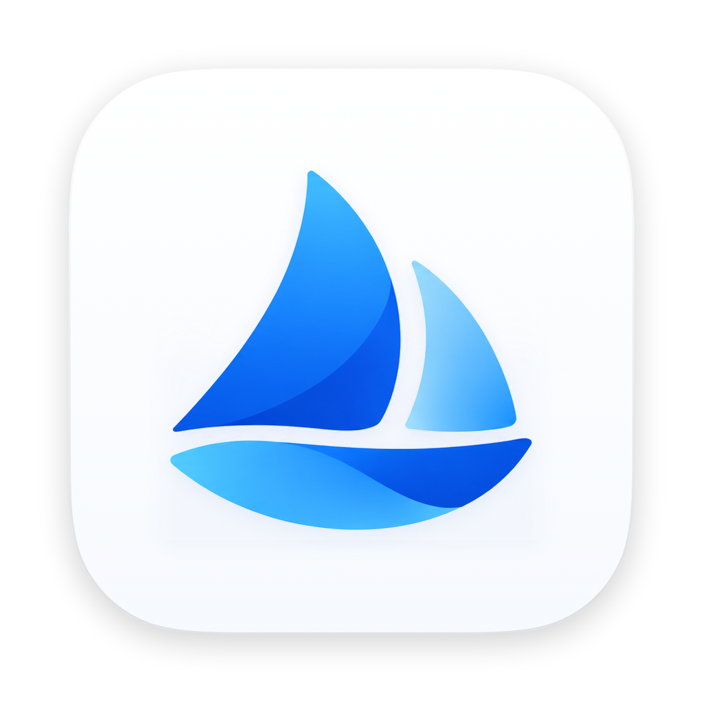

# 小帆船 · Little Sailboat
### 专为 Claude & Claude Code 打造的原生环境管理与安全护航控制台

  <strong>让每一次 AI 交互，都在纯净、透明、物理硬阻断的极安全环境中扬帆起航。</strong>

**[简体中文](README.md)** · **[English](README.en.md)** · **[使用指南](docs/使用指南.md)** · **[注意事项与隐私说明](docs/注意事项与隐私说明.md)** · **[反馈建议](https://github.com/zhongyuanl/xiaofanchuan/issues)**

---

## 💡 为什么你的 Claude 账号总在莫名被封？

在使用 **Claude 网页版 / 桌面端** 与 **Claude Code (命令行 CLI)** 时，许多开发者都遭遇过毫无征兆的封号风控。这背后往往不是账号本身的问题，而是潜藏在操作系统底层的网络环境隐患：

- **⚠️ 掉线静默裸连**：代理节点偶发抖动或断开时，系统极易静默回落到本地网络，国内真实 IP 瞬间直连暴露，触发 Anthropic 严格风控；
- **⚠️ CLI 与子进程裸奔**：在终端运行 Claude Code 时，后台调用的 `npx`、`uvx`、`git`、`curl` 以及 MCP 命令行子进程根本不读取常规代理环境变量，在内核底层频频直连泄露；
- **⚠️ 环境特征自相矛盾**：网络出口在海外，但本地时区仍是东八区、DNS 频频向本地运营商泄漏、WebRTC/STUN 协议在底层悄悄广播真实物理 IP；
- **⚠️ 会话污染与异地瞬移**：日常浏览与 AI 开发混用同一个浏览器，多账号 Cookie 互相串号；上午在美西、下午在东京，极易被判定为异地盗号。

**小帆船（Little Sailboat）全新一代架构正是为了彻底解决这些痛点而生！**  
它将本地物理断流水闸、内核级双引擎底座、全要素环境核验与三端沙盒启动浓缩在一个极致优雅的原生控制中心，为你的高价值 Claude 账号打造坚不可摧的护航屏障。

---

## 🌟 全新版本核心特色与亮点

### 🍏 1. 极致原生 Apple 毛玻璃美学与 3D 点阵视界
- **纯 Swift 6 + SwiftUI + AppKit 原生重构**：彻底告别跨平台框架的臃肿与延迟，启动如闪电，原生毛玻璃与系统浑然一体。
- **422pt 震撼 3D 点阵交互地球仪**：内置高性能原生底层手势追踪，支持鼠标 360° 自由拖拽旋转、双击平滑复位，实时呈现真实物理起点出境飞线与出口同心圆动态光波。
- **自适应等高几何排版**：在 900×650 最小窗口下，通行页三大核心卡片（代理环境、安全护航、启动 Claude）高度完全自适应统一，呼吸感留白，免滚动一览全貌。

### 🛡️ 2. 独创 Fail-Closed 物理硬阻断安全水闸 (`127.0.0.1:17897`)
- **宁可断网，绝不裸奔**：自建专用本地安全水闸。在网络波动、节点掉线或环境未合规时，水闸坚决执行硬阻断——**绝不放行任何未经核验的流量直连，彻底杜绝真实 IP 暴露风险**。
- **全要素环境一致性核验**：出口 IP 纯净度检测（区分机房与原生家宽）、全球 185 个国家/地区合规识别、本地时区严格自动对齐；同时对海外华人中文习惯贴心豁免，严苛安全却极富温度。
- **宽容守护机制**：只要底层代理隧道存活且出口走向未变，绝不因单次探针偶发抖动而误切断流，告别假超时频频打扰。

### ⚡ 3. 「系统代理 + TUN 虚拟网卡」强制双开内核底座
- **不留死角**：底层强制同时启用「系统代理 + TUN 虚拟网卡」。桌面端与浏览器走高效代理通道；TUN 虚拟网卡在内核层全面接管所有 CLI 终端命令、MCP 命令行子进程、UDP 与底层 DNS，杜绝任何旁路直连。
- **全域零泄漏保障**：通过远端加密 DoH DNS 与 STUN 协议拦截，实现真正的零 DNS 泄漏与零 WebRTC 泄漏。

### 🌐 4. 双引擎自由切换与「智能分流 ｜ 全量出海」
- **内置代理专核**：集成高性能独立专核（监听 17898/17899/17895），直接导入订阅源，单节点与批量并发异步毫秒级测速。
- **外部客户端无缝协同**：深度兼容外部已有代理客户端；独创**「系统代理一键修复」**，秒级识别当前真正联网的网卡（Wi-Fi / 有线 / USB 网卡）并智能恢复配置，换电脑或网卡切换时一键排障。
- **智能分流极简二选一**：
  - **智能分流（日常推荐）**：国内网页、微信、局域网直连秒开；Claude 全系与海外流量走安全专线。遇到特定内网网址，直接粘贴网址即可自动生成直连规则；
  - **全量出海（深度场景）**：整台电脑 100% 流量出海，满足深度跨境开发需求。

### 🚀 5. 三端一键独立沙盒启动台
- **Claude 官方桌面端**：一键接管网络环境与后台 MCP 依赖。
- **独立安全沙盒浏览器**：内置专用沙盒环境，完全独立于日常主浏览器，Cookie 与缓存绝不串号，提供无污染纯净对话环境。
- **Claude Code 命令行终端**：一键自动注入受控环境变量与水闸中继，告别手动 `export` 的繁琐与写坏 `settings.json` 的风险。
- **退出安全清场**：退出小帆船时主动弹窗提示并清场受控进程，防止退出后后台进程意外滑落至本地直连网络。

### 🧭 6. 24 小时防瞬移保护与多账号沙盒
- 智能监控出口地理跃迁，只有当用户真正启动并使用 Claude 时才计入差旅切换，防止后台测速或切节点误判跨国瞬移；
- 多账号环境数据物理隔离，轻松管理多个 Claude 账号资产。

---

## 🖼️ 界面实机预览

### 1. 通行控制中心
三大卡片等高排布：3D 点阵地球仪实时展示出境飞线与出口位置；安全护航卡片守护物理水闸；底部一键拉起桌面端、安全浏览器与终端。

 

### 2. 代理环境与订阅管理
支持内置代理与外部客户端无缝切换，管理订阅源与节点列表，单节点异步毫秒级测速，直连规则一键配置。

 

### 3. 环境配置与设置中心
统筹系统时区、网络端口与开机配置，提供贴心的一键设置助理与系统代理智能修复工具。

> 📌 *注：界面截图中展示的订阅名称、节点标签及网络出口均为用于演示的示例数据。*

---

## 📥 获取与安装

| 平台 | 版本 | 安装包 | 运行环境要求 | 说明 |
| :--- | :--- | :--- | :--- | :--- |
| **macOS** | **v2.0.3** | [**DMG 镜像**](https://github.com/zhongyuanl/xiaofanchuan/releases/download/v2.0.3/Little-Sailboat-v2.0.3-macOS.dmg) · [ZIP 压缩包](https://github.com/zhongyuanl/xiaofanchuan/releases/download/v2.0.3/Little-Sailboat-v2.0.3-macOS.zip) | Apple Silicon (M1/M2/M3/M4 系列)，macOS 13.0 或更高版本 | 原生 Swift 6 架构，自带苹果弧线指引安装界面 |
| **Windows** | **v1.3.23** | [**EXE 单文件**](https://github.com/zhongyuanl/xiaofanchuan/releases/download/v1.3.23/Little-Sailboat-v1.3.23-Windows-x64.exe) · [ZIP 压缩包](https://github.com/zhongyuanl/xiaofanchuan/releases/download/v1.3.23/Little-Sailboat-v1.3.23-Windows-x64.zip) | Windows 10 / 11 64 位 | 纯绿色免安装，内置极速 WebView2 运行时支持 |

> 💡 **macOS 安装提示**：  
> 双击打开 DMG 后，将「小帆船」图标拖入右侧 Applications 文件夹即可完成安装。由于开源版本采用本地签名，若首次打开出现系统安全提示，请前往「系统设置 → 隐私与安全性」点击「仍要打开」。下载后可使用发布页的 [SHA256SUMS.txt](https://github.com/zhongyuanl/xiaofanchuan/releases/download/v2.0.3/SHA256SUMS.txt) 进行完整性校验。

---

## ⚡ 极速上手：3 步起航

1. **第一步：接入代理**
   - 在「环境 → 代理环境」导入您的订阅源，或选择外部代理客户端并填写本地端口。
2. **第二步：自动核验与一键配置**
   - 小帆船自动探测出口 IP 归属地与纯净度，水闸即时校验时区与无泄漏防护。
3. **第三步：安全放行，从容起航**
   - 点击开启「**安全护航**」，在通行页一键启动 **Claude 桌面端**、**沙盒浏览器** 或 **Claude Code 终端**，即刻在绝对受控的安全通道中畅享 AI 协作！

---

## 🛡️ 安全、合规与设计理念

- **纯净中立的辅助定位**：小帆船是一款纯粹的客户端运行环境自检与启动调度控制台。**本项目不提供、不内置、不销售任何网络节点、代理服务或第三方账号**，用户需自行准备合规网络环境。
- **受控而非侵入**：本地安全水闸仅对受控流量与由小帆船拉起的进程生效，杜绝意外旁路直连，绝不非法 hook 系统底层。
- **资产安全第一**：针对配置变更实行快照备份机制，保护用户重要配置与密钥资产。详情见 [注意事项与隐私说明](docs/注意事项与隐私说明.md)。

---

## 🤝 致谢与开源生态

小帆船的诞生离不开开源社区的杰出成果：
- [Mihomo](https://github.com/MetaCubeX/mihomo)：卓越的代理内核与底层标准参考。
- [CCBaga](https://github.com/liseami/CCBaga)：出色的地区匹配逻辑与字典复用。
- [Clash Verge Rev](https://github.com/clash-verge-rev/clash-verge-rev)：优秀的客户端架构与跨平台实践参考。

详细许可范围见 [LICENSE](LICENSE.md)，第三方依赖来源见 [参考项目与许可](docs/参考项目与许可.md) 及 [THIRD_PARTY_NOTICES.txt](THIRD_PARTY_NOTICES.txt)。

---

**⛵ 让每一次与 AI 的协作，都从容不迫。**  
欢迎提交 [Issue](https://github.com/zhongyuanl/xiaofanchuan/issues) 或 Star 支持，共同把小帆船打磨得更好！

