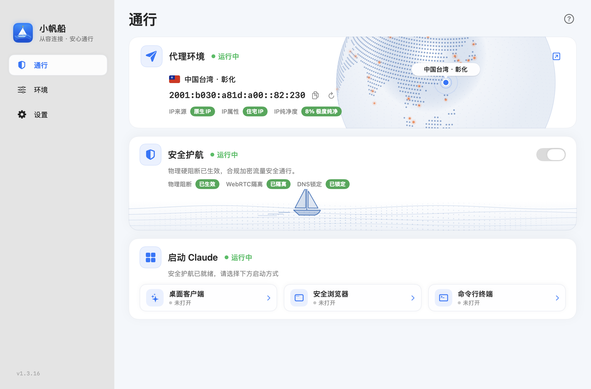
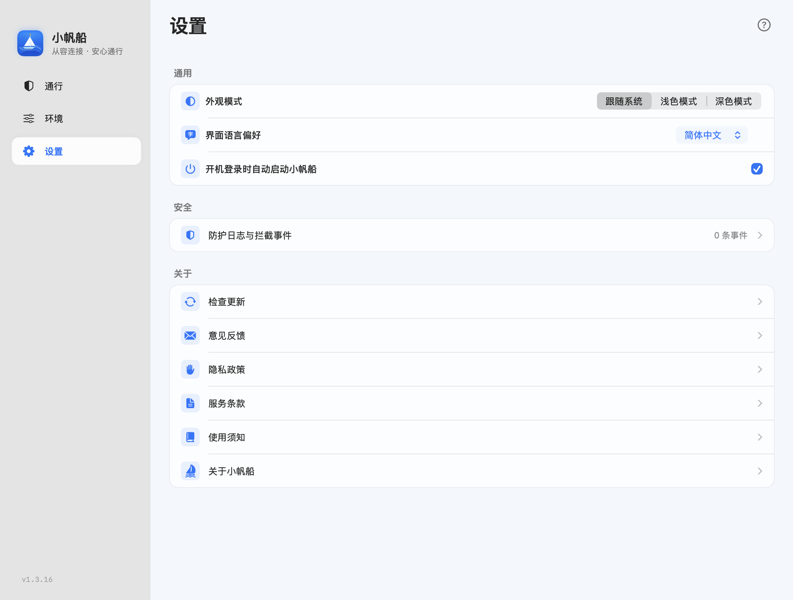
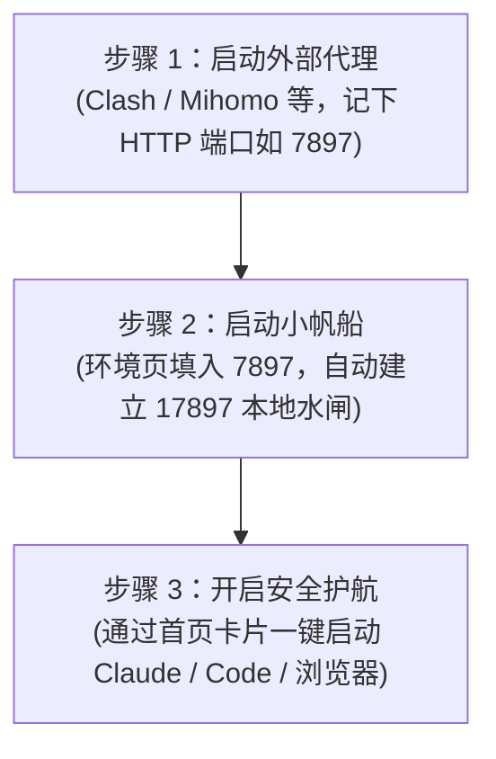

<div align="center">



# 小帆船 · Little Sailboat
### 专为 Claude & Claude Code 打造的原生环境管理与安全守护控制台

<p align="center">
  <strong>让每一次 AI 交互，都在透明、纯净、受控的环境中扬帆起航。</strong>
</p>

[](https://github.com/zhongyuanl/xiaofanchuan/releases/tag/v1.3.19)
[](https://github.com/zhongyuanl/xiaofanchuan/releases/tag/v1.3.19)
[](https://github.com/zhongyuanl/xiaofanchuan/releases/tag/v1.3.19)
[](https://github.com/zhongyuanl/xiaofanchuan)
[](https://github.com/zhongyuanl/xiaofanchuan/releases)

**[简体中文](README.md) | [English](README.en.md)**

[**📥 立即下载 v1.3.19**](https://github.com/zhongyuanl/xiaofanchuan/releases/tag/v1.3.19) · [**📖 使用指南**](docs/使用指南.md) · [**❓ 常见问答**](docs/使用指南.md#7-常见问题) · [**⚠️ 注意事项与隐私**](docs/注意事项与隐私说明.md) · [**🐛 反馈建议**](https://github.com/zhongyuanl/xiaofanchuan/issues)

</div>

---

## 💡 为什么需要小帆船？

在使用 **Claude 网页版 / 桌面端** 与 **Claude Code (命令行 CLI)** 时，开发者常面临繁琐的环境与网络痛点：

- **意外直连风险**：上游代理客户端波动或断开时，系统极易发生静默回落直连，导致真实 IP 泄露，触发不必要的账号安全风控。
- **环境信息割裂**：网络出口在海外，而系统语言、时区或 IPv6 仍处于国内状态，环境特征前后矛盾。
- **配置容易写坏**：每次启动 Claude Code 都要手动 `export` 环境变量；直接修改 `~/.claude/settings.json` 又容易手滑破坏原有的 API Key、自定义网关或导致 JSON 语法损坏。
- **浏览器会话污染**：日常浏览与 AI 研发混用同一个浏览器 Profile，Cookie 与插件复杂，缺乏沙盒隔离。

**小帆船（Little Sailboat）正是为此而生的轻量、现代化环境编排控制台。** 它把复杂的网络水闸控制、双源出口探测、系统时区对齐、配置安全快照及多端一键启动，浓缩进一个简洁优雅的控制中心。

---

## ✨ 核心特性矩阵

| 特性 | 功能说明 | 带来价值 |
| :--- | :--- | :--- |
| 🛡️ **受控本地水闸**<br>`Fail-Safe Gate` | 本地自建 `127.0.0.1:17897` 专属中继，仅放行经核验的受控流量；网络或代理异常时主动阻断 | **零旁路泄露**：绝不静默直连，牢牢守护网络边界 |
| 🌐 **双源出口真实探针**<br>`Dual Probe` | 并发请求双权威 IP 数据源，交叉比对公网 IPv4、ASN、运营商与地理位置 | **所见即真实**：废除虚假测速打分，状态一目了然 |
| 🚀 **全端一键启动台**<br>`Unified Launcher` | 集中启动 Claude Desktop、Claude Code 终端以及独立沙盒浏览器（Edge / Chrome） | **开箱即用**：自动挂载安全代理与环境变量，无需繁琐设置 |
| 🌍 **系统环境无缝协调**<br>`Environment Harmony` | 一键检查系统语言、时区与出口地区的匹配状态，支持一键协调与 IPv6 优化 | **环境一致性**：消弭时区冲突与定位异常造成的潜在风控 |
| 💾 **Claude Code 配置安全哨兵**<br>`Config Sentinel` | 写入配置前自动生成 5 代带时间戳备份；严格校验 JSON 语法，自动保留 `sk-ant-` 密钥 | **绝不丢资产**：支持随时一键回退，保护开发者个性化配置 |
| 🧰 **精细化分级数据治理**<br>`Tiered Repair` | 细分为“仅退出重登”、“清理运行缓存”与“完整环境重置”，提供变更范围预览 | **安全可控**：告别“一刀切”式野蛮删除，保留核心工程数据 |

---

## 🖼️ 界面实机预览

<div align="center">

### 1. 通行控制中心 (Dashboard)
实时监测出口 IP、ASN 运营商、地理位置与本地受控水闸状态，支持一键启停护航与多端启动。



<br/>

### 2. 环境与网络配置 (Settings)
轻量配置上游代理端口（如 Clash 7897），对齐地区语言偏好，掌握每一项底层变动。



</div>

---

## 📥 下载与安装

小帆船提供 **macOS (Apple Silicon)** 与 **Windows (x64)** 双端原生版本，按需选择下载：

### 平台下载矩阵

| 操作系统 | 下载文件 | 推荐度 | 说明 |
| :--- | :--- | :--- | :--- |
| **macOS** (13.0+) | [**`Little-Sailboat-v1.3.19-macOS.dmg`**](https://github.com/zhongyuanl/xiaofanchuan/releases/download/v1.3.19/Little-Sailboat-v1.3.19-macOS.dmg) | ⭐⭐⭐⭐⭐ **首选推荐** | 双击打开 DMG，将 APP 拖入 Applications 即可 |
| **macOS** (13.0+) | [`Little-Sailboat-v1.3.19-macOS.zip`](https://github.com/zhongyuanl/xiaofanchuan/releases/download/v1.3.19/Little-Sailboat-v1.3.19-macOS.zip) | ⭐⭐⭐⭐ | 解压即用绿色包 |
| **macOS** (13.0+) | [`Little-Sailboat-v1.3.19-app.tar.gz`](https://github.com/zhongyuanl/xiaofanchuan/releases/download/v1.3.19/Little-Sailboat-v1.3.19-app.tar.gz) | ⭐⭐⭐ | 完整 APP Bundle 目录归档 |
| **Windows** (10/11) | [**`Little-Sailboat-v1.3.19-Windows-x64.exe`**](https://github.com/zhongyuanl/xiaofanchuan/releases/download/v1.3.19/Little-Sailboat-v1.3.19-Windows-x64.exe) | ⭐⭐⭐⭐⭐ **首选推荐** | 单文件免安装，内置极速 WebView2 核心 |
| **Windows** (10/11) | [`Little-Sailboat-v1.3.19-Windows-x64.zip`](https://github.com/zhongyuanl/xiaofanchuan/releases/download/v1.3.19/Little-Sailboat-v1.3.19-Windows-x64.zip) | ⭐⭐⭐⭐ | 包含使用说明文档的绿色压缩包 |

> [!TIP]
> **完整性校验**：所有安装包均提供官方 SHA-256 哈希清单，可在发布页下载 [`SHA256SUMS.txt`](https://github.com/zhongyuanl/xiaofanchuan/releases/download/v1.3.19/SHA256SUMS.txt) 进行核验。

---

## ⚡ 极速上手：3 步起航



1. **第一步：就绪上游代理**
   - 打开您常用的代理客户端（如 Clash Verge Rev、Mihomo Party），确认节点联网正常，查看本地 HTTP / mixed 监听端口（常见默认端口为 `7897`）。
2. **第二步：配置小帆船并自检**
   - 启动小帆船，在「环境 → 网络」填入上游代理端口（如 `7897`），选择预期的出口国家/地区。
   - 小帆船将启动本地受控中继水闸（`127.0.0.1:17897`）并自动执行双源探测，确认真实出口 IP 及 ASN 归属。
3. **第三步：开启护航，愉快起航**
   - 当状态指示灯呈现健康状态后，点击开启「**安全护航**」。
   - 从控制台工作台一键点击启动 **Claude 桌面端**、**Claude Code 终端** 或 **独立沙盒浏览器**，自动注入受控网络环境！

---

## 🏗️ 推荐部署方案

小帆船支持灵活适配不同的安全偏好与工作模式：

| 方案 | 架构说明 | 优点 | 适用人群 |
| :--- | :--- | :--- | :--- |
| **A. 独立 macOS 虚拟机**<br>*(极客深度推荐)* | 在 UTM / Parallels Desktop 中运行 macOS 虚拟机，将小帆船、代理与 Claude 工具全部运行在虚拟机内 | **100% 环境物理隔离**：系统语言、时区变动完全不影响宿主机日常办公；会话资料完全独立 | 追求极致纯净环境的高级开发者、深度 AI 重度用户 |
| **B. Mac 宿主机原生运行**<br>*(日常高效直连)* | 直接在当前日常使用的 Apple Silicon Mac 上运行应用 | **轻量零开销**：无需分配额外内存与 CPU，随开随用，原生流畅体验 | 日常轻量开发、需要直接调用宿主机本地工程资产的用户 |
| **C. Windows 单文件便携**<br>*(即开即用)* | 下载单个 EXE 直接运行，通过 WebView2 呈现轻量控制台 | **便携无依赖**：无需安装或管理员配置，随身 U 盘随时携带 | Windows 10/11 平台用户 |

---

## 🛡️ 安全、合规与设计理念

- **🔒 纯净透明的辅助定位**：小帆船是一款纯粹的客户端运行环境自检与启动调度控制台。**本项目不提供、不内置、不销售任何网络节点、代理服务或第三方账号**。
- **🛡️ 受控而非侵入**：小帆船的安全水闸仅对经过 `127.0.0.1:17897` 本地中继及由控制台拉起的受控进程生效，杜绝意外旁路直连；它不会非法 hook 系统核心或擅自接管未授权应用。
- **💾 资产安全为第一准则**：所有对配置的变动均实行「先校验、留快照、支持回滚」机制，杜绝任何未经确认的数据抹除。详情见 [注意事项与隐私说明](docs/注意事项与隐私说明.md)。

---

## ❓ 常见问答 (FAQ)

<details>
<summary><strong>Q1: macOS 打开提示「无法验证开发者」或「已损坏」怎么办？</strong></summary>

这是由于开源版本采用本地临时签名（Ad-hoc），未加入苹果商业年审公证导致。可通过以下任一方式正常打开：
1. 打开系统「系统设置 → 隐私与安全性」，下滑找到小帆船的拦截提示，点击「仍要打开」；
2. 或者在终端执行命令清除隔离属性：
   ```bash
   sudo xattr -rd com.apple.quarantine "/Applications/Little Sailboat.app"
   ```
</details>

<details>
<summary><strong>Q2: 上游代理填 7897 还是 17897？</strong></summary>

- `7897`（或您代理软件显示的端口）是**上游输入端口**，需要在小帆船设置里填入；
- `17897` 是**小帆船自身的本地受控水闸端口**，它负责向 Claude 和终端提供受控中继，无需在小帆船设置里重复填写 `17897`。
</details>

<details>
<summary><strong>Q3: 为什么 Windows 版提示缺少 WebView2？</strong></summary>

Windows 版基于现代微软 WebView2 核心渲染。Windows 11 及更新后的 Windows 10 系统通常已预装。如精简版系统提示缺失，请前往 [微软官网下载安装 WebView2 Runtime](https://developer.microsoft.com/microsoft-edge/webview2/) 即可。
</details>

<details>
<summary><strong>Q4: 为什么没有 Intel (x86_64) Mac 版本？</strong></summary>

当前 macOS 版本深度优化并编译自 Apple Silicon (arm64) 原生架构。Intel 架构 Mac 暂不在支持清单中。
</details>

---

## 🤝 致谢与开源生态

小帆船的诞生离不开开源社区的优秀成果：
- [CCBaga](https://github.com/liseami/CCBaga)：实际复用其出色的 Rust 地区字典与匹配逻辑（MIT 协议）。
- [Clash Verge Rev](https://github.com/clash-verge-rev/clash-verge-rev) & [Mihomo](https://github.com/MetaCubeX/mihomo)：优秀的代理内核与配置标准参考。
- [Magic UI](https://github.com/magicuidesign/magicui)、[Impeccable](https://github.com/pbakaus/impeccable)、[Emil Kowalski skills](https://github.com/emilkowalski/skills)：UI 设计理念与交互动效灵感。

详细授权信息与第三方通知请见 [参考项目与许可](docs/参考项目与许可.md) 及 [THIRD_PARTY_NOTICES.txt](THIRD_PARTY_NOTICES.txt)。

---

<div align="center">

**⛵ 让每一次与 AI 的协作，都从容不迫。**  
欢迎提交 [Issue](https://github.com/zhongyuanl/xiaofanchuan/issues) 或加入讨论，共同把小帆船打磨得更好！

</div>
